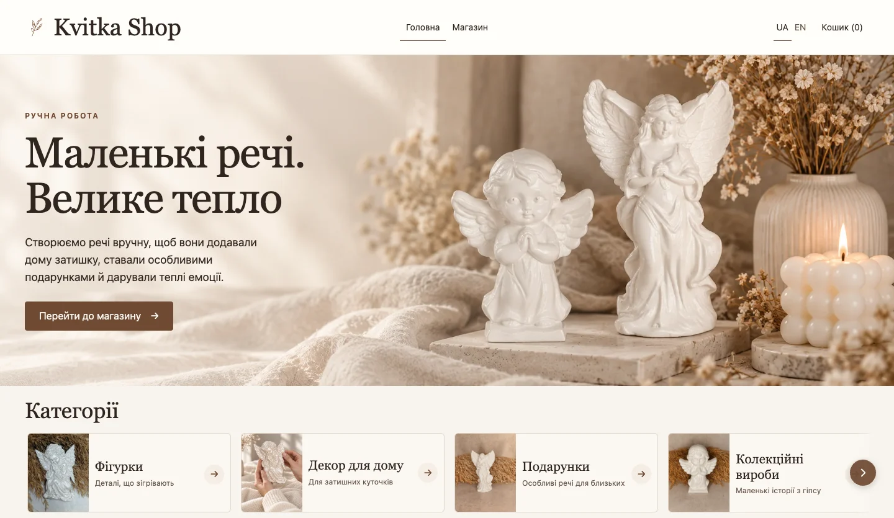

# Kvitka Shop

A bilingual storefront for handmade decor and gifts. This portfolio edition runs on a sample catalog and keeps the original shop’s warm palette, photography, and responsive layouts.



- Ukrainian and English storefront with a responsive category carousel.
- Search, category filtering, and price sorting, with compact filters on phones.
- Product galleries, color variants, and availability for sample products.
- A browser-local cart and a demo checkout with no personal information or payment.

## Run locally

With Python 3:

```sh
python3 -m http.server 4173 --bind 127.0.0.1 --directory public
```

Open [localhost:4173](http://localhost:4173). No package install, external services, environment variables, or credentials are required. To host the demo on any static server, use `public/` as its document root.

Run the catalog and cart tests with Node.js 22 or newer:

```sh
npm test
```

`public/src/catalog.js` defines the sample catalog. `store.js` contains the catalog and cart rules, `carousel.js` handles scrolling, and `main.js` renders the storefront. The public repository contains the storefront demo only.
